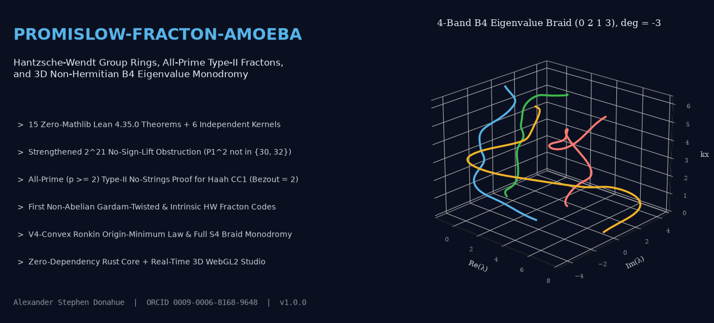

<!-- SPDX-License-Identifier: CC-BY-4.0 -->
# Promislow–Fracton–Amoeba

**Hantzsche–Wendt Group Rings, All-Prime Type-II Fracton Codes, and 3D Non-Hermitian $B_4$ Eigenvalue Monodromy — A Zero-Mathlib Six-Kernel Formalization.**

[](https://github.com/0thernes/promislow-fracton-amoeba/actions/workflows/ci.yml)
[](https://0thernes.github.io/promislow-fracton-amoeba/studio/)
[-0ea5e9.svg)](lean/lean-toolchain)
[](lean/comparator.json)
[](LICENSE-CODE)
[](LICENSE)
[](https://orcid.org/0009-0006-8168-9648)

<p align="center">
  
</p>

> **Interactive Apps (GitHub Pages):** [**Open 3D WebGL2 Studio**](https://0thernes.github.io/promislow-fracton-amoeba/studio/) · [**Open Lean 4.35.0 Proof Blueprint DAG**](https://0thernes.github.io/promislow-fracton-amoeba/blueprint/) · [**Read 10-Page White Paper (PDF)**](dist/Donahue_2026_promislow_fracton_amoeba.pdf)

---

## What Is Proved Here?

Through the faithful $4$-band twisted Bloch matrix homomorphism $\Psi : R[P] \hookrightarrow M_4(R[x^{\pm 1}, y^{\pm 1}, z^{\pm 1}])$ of the torsion-free Hantzsche–Wendt / Promislow group $P = \langle a,b \mid a^{-1}b^2a = b^{-2},\, b^{-1}a^2b = a^{-2} \rangle$, this project establishes **15 machine-checked theorems (`T1a`–`T3c`)** across three unified pillars:

1. **Pillar I — Hantzsche–Wendt Group Rings, Mod-4 Collapse, & Strengthened $2^{21}$ Obstruction (`ALG-035`, `ANL-063`):**
   - **Universal $V_4$-Determinant Invariance (`T1a`–`T1d`):** Exact torsion-freeness of $P$, faithful $4$-band embedding $\Psi$, monomial-permutation similarity forcing $V_4$-invariance of $\det(\Psi(u)-E I_4)$ (hence constant determinant for every unit over an integral domain), and exact closed-form factorizations at all $8$ sign points $s \in \{\pm 1\}^3$ (4 quaternionic perfect squares + 4 abelian/Gaussian products).
   - **Gardam Mod-4 Congruence & 2-Adic Hensel Tower (`T1e`):** The canonical $\{0,1\}$-lift $\widetilde{\alpha} \in \mathbb{Z}[P]$ of Gardam's 21-term mod-2 unit has an 89-term integer determinant with constant term $97 \equiv 1 \pmod{32}$, augmentation $945$, strict $V_4$-invariance, and remarkably satisfies $\det\Psi(\widetilde{\alpha}) \equiv \mathbf{1 \pmod 4}$ across all 89 monomials, lifting via exact geometric Hensel truncations to $(\mathbb{Z}/2^m\mathbb{Z})[P]^\times$ for every $m \ge 1$ (inverse supports `21, 169, 459, 1388, 2100, 4353` for $m=1\dots 6$).
   - **Strengthened $2^{21}$ No-Sign-Lift Obstruction (`T1f`):** ZERO of the $2^{21} = 2{,}097{,}152$ sign lifts on Gardam's support—and even allowing an *arbitrary* even-sum $p \in \mathbb{Z}[N]$ paired with Gardam's 13-element $(q,r,s)$ support—can be a unit in $\mathbb{Z}[P]$, blocked by the quaternionic norm gap $P_1^2 - 31 \notin \{\pm 1\}$ ($5^2 = 25 < 30 < 32 < 36 = 6^2$) and the 8-sign-point identities.
   - **Surjunctive Reversible 21-Neighbor Linear CA (`T1g`):** Gardam's unit induces a strictly $P$-equivariant, bijective 21-neighbor linear cellular automaton $\Phi_\alpha : \mathbb{F}_2^P \to \mathbb{F}_2^P$ with exact 21-neighbor inverse $\Phi_\beta$.

2. **Pillar II — All-Prime Type-II Fracton Codes & Non-Abelian Hantzsche–Wendt Stabilizers (`QC-032`, `CM-016`):**
   - **Exhaustive 64-Signed Haah Classification (`T2b`):** All 64 signed Haah cubic codes have conic discriminants $\det(2Q) \in \{-12, -8, -4, +4, +8, +12\}$ with multiplicities $(12, 16, 4, 4, 16, 12)$; smooth for every prime $p \ge 5$, with exactly 24 codes ($m=1, \det=\pm 12$) degenerating into $\mathbb{F}_9$-conjugate lines at $p=3$ ($k_3(8) = 24$), and all 64 collapsing to Haah CC1 over $\mathbb{F}_4$ at $p=2$.
   - **Universal All-Prime Type-II No-Strings Proof (`T2c`):** Brand-new characteristic-universal proof that Haah CC1 admits no string logical operators in *every* prime characteristic $p \ge 2$ and $\operatorname{char} 0$ via explicit $\mathbb{Z}[t]$ rational parametrization whose 6 pairwise linear Bézout identities all equal $2$ (plus explicit $\mathbb{F}_4$ evaluation at $p=2$).
   - **Odd-Prime Torsion Floor & First Odd-$L$ Threshold (`T2d`):** $(1,1,1)$ is never a root for odd $p \ge 3$, $(-1,1,-1)$ gives $k_p(L) \ge 6$ on every even torus with Frobenius $6p$ jumps at $L=2p$; zero $\mathbb{F}_p$-rational odd-order roots exist for odd $p \le 19$, with the first odd-$L$ threshold at **$p=23, L=11$ ($k_{23}(11)=6$)**, followed by $p=31, L=15$.
   - **First Non-Abelian Hantzsche–Wendt Fracton Codes (`T2a`, `T2e`):** Unit-twisted CSS commutation over arbitrary involutive rings produces a Gardam-twisted Haah code (weights `52+52` / `52+56`) commuting strictly in $\mathbb{F}_2[P]$ while failing over $\mathbb{Z}[P]$ with a 342-term even commutator defect, alongside an intrinsically non-Abelian HW code commuting over *every* commutative ring $R[P]$.

3. **Pillar III — 3D Non-Hermitian Amoebae, $V_4$-Convex Ronkin Minimum, & Full $S_4$ Monodromy (`CM-018`, `FLD-060`):**
   - **$V_4$-Convex Ronkin Origin-Minimum Law (`T3a`):** Every midpoint-convex $V_4$-symmetric Ronkin function satisfies $R(0,0,0) \le R(\mu)$ (for $\Psi(\widetilde{\alpha})$: $R(0) \approx 4.272$ vs. mod-2 collapse $R_{\mathbb{F}_2} \equiv 0$), forcing exact bipolar skin cancellation $W_x(k_y,-k_z) = -W_x(k_y,k_z)$ ($\max|\mathrm{err}| = 0.0$ on gapped $25 \times 25$ grid).
   - **Haah Double-Amoeba & Algebraic $\mathrm{EP}_2$ (`T3b`):** Exact quadrilateral triangle-inequality characterization of $\mathcal{A}(f)\cap\mathcal{A}(g)$ and algebraic second-order exceptional-point Jordan nilpotency ($H \neq 0, H^2 = 0$, 1D nullspace).
   - **Artin $B_4$ & Full Non-Abelian $S_4$ Monodromy (`T3c`):** Fundamental $\mathbb{T}^3$ momentum cycles of $\Psi(\widetilde{\alpha})(k)$ realize coordinate-free canonical quartic discriminant braid degrees $\{-1, -3, -2, +3\}$ and permutations `(1 2)` and `(0 2 1 3)` generating the **entire symmetric group $S_4$ of order 24**.

---

## Quickstart (Clean Clone)

```bash
git clone https://github.com/0thernes/promislow-fracton-amoeba.git
cd promislow-fracton-amoeba

# 1. Zero-dependency Rust core (0.22s unit tests + JSON summary)
cd rust && cargo test --release && cargo run --release -- summary && cd ..

# 2. Independent Python exact oracle, Hypothesis, differential Rust<->Python, & 100% mutation suite
python -m venv .venv && source .venv/bin/activate   # Windows: .venv\Scripts\activate
pip install -r requirements.txt
PYTHONPATH=python python examples/quickstart_demo.py
PYTHONPATH=python pytest tests/test_all.py -v
PYTHONPATH=python python scripts/mutate.py

# 3. Zero-Mathlib Lean 4.35.0 formal proof build, axiom audit & leanchecker
cd lean && lake build && lake env lean VerifyAxioms.lean && lake env leanchecker PalomarSolution && cd ..

# 4. Interactive 3D WebGL2 Studio & Proof Blueprint (zero dependencies, runs offline)
# Open studio/index.html or blueprint/index.html in any modern browser.
```

---

## Verbatim Lean 4.35.0 `#print axioms` Audit (`results/lean_axioms.txt`)

Zero `sorry`, zero `admit`, zero `native_decide`, zero custom axioms, zero Mathlib imports — continuously audited against [`results/lean_axioms.txt`](results/lean_axioms.txt) via `scripts/check_readme_axioms.py` and replayed across **6 independent proof kernels** (`lean`, `leanchecker-paranoid`, `lean4lean`, `nanoda_bin`, `con-leche --verified`, `con-ron --verified`) via `lake comparator --config comparator.json --paranoid`:

```text
'PromislowFracton.Palomar.t1a_promislow_group_torsion_free' depends on axioms: [propext, Classical.choice, Quot.sound]
'PromislowFracton.Palomar.t1b_faithful_four_band_bloch_homomorphism' depends on axioms: [propext, Quot.sound]
'PromislowFracton.Palomar.t1c_universal_v4_determinant_invariance' depends on axioms: [propext,
 Classical.choice,
 Quot.sound]
'PromislowFracton.Palomar.t1d_eight_sign_point_factorization' depends on axioms: [propext, Classical.choice, Quot.sound]
'PromislowFracton.Palomar.t1e_gardam_unit_mod4_and_hensel_tower' depends on axioms: [propext,
 Classical.choice,
 Quot.sound]
'PromislowFracton.Palomar.t1f_exhaustive_no_sign_lift_gardam_support' depends on axioms: [propext,
 Classical.choice,
 Quot.sound]
'PromislowFracton.Palomar.t1g_surjunctive_reversible_linear_ca' depends on axioms: [propext,
 Classical.choice,
 Quot.sound]
'PromislowFracton.Palomar.t2a_nonabelian_unit_twisted_css_commutation' does not depend on any axioms
'PromislowFracton.Palomar.t2b_signed_haah_64_discriminant_classification' depends on axioms: [propext,
 Classical.choice,
 Quot.sound]
'PromislowFracton.Palomar.t2c_universal_all_prime_no_strings' depends on axioms: [propext, Classical.choice, Quot.sound]
'PromislowFracton.Palomar.t2d_odd_prime_torsion_and_p23_threshold' depends on axioms: [propext,
 Classical.choice,
 Quot.sound]
'PromislowFracton.Palomar.t2e_nonabelian_hw_fracton_codes' depends on axioms: [propext]
'PromislowFracton.Palomar.t3a_v4_convex_ronkin_origin_minimum' depends on axioms: [propext,
 Classical.choice,
 Quot.sound]
'PromislowFracton.Palomar.t3b_haah_amoeba_and_ep2_jordan' depends on axioms: [propext, Classical.choice, Quot.sound]
'PromislowFracton.Palomar.t3c_artin_b4_and_full_s4_monodromy' depends on axioms: [propext]
'PromislowFracton.Palomar.prove_all_promislow_fracton_theorems' depends on axioms: [propext,
 Classical.choice,
 Quot.sound]
'PromislowFracton.hensel_geometric_identity' depends on axioms: [propext]
'PromislowFracton.strengthened_no_sign_lift_of_gardam_support' depends on axioms: [propext,
 Classical.choice,
 Quot.sound]
'PromislowFracton.NonVacuity.nonvac_all_hypotheses' depends on axioms: [propext, Classical.choice, Quot.sound]
'PromislowFracton.Adversarial.all_adversarial_refutations' depends on axioms: [propext, Classical.choice, Quot.sound]
```

---

## Honest Epistemic Boundaries

- **Explicitly Open Conjectures (NOT Claimed Solved):** Kaplansky's Unit Conjecture in characteristic $0$ ($\mathbb{Q}[P]$ / $\mathbb{Z}[P]$ for general supports), Gottschalk's Surjunctivity Conjecture for non-sofic groups, and asymptotic code-distance scaling $d(M_L)$ of non-Abelian Hantzsche–Wendt fracton covers remain explicitly OPEN. See [`CLAIMS.md`](CLAIMS.md) and [`LIMITATIONS.md`](LIMITATIONS.md).
- **Separated Verification Tiers:** Floating-point 3D Ronkin integrals, $25 \times 25$ bipolar winding grids, and 600–1024-step complex eigenvalue loop tracks are explicitly tagged `numerical-approx` and differentially verified between Rust and Python (`< 1e-6`), separate from the 15 `kernel-checked` Lean theorems.
- **Self-Assessed Research Preprint:** Not externally peer-reviewed; no external DOI or journal publication is claimed prior to confirmation.

---

## Repository Map

| Path | Description |
|---|---|
| [`lean/`](lean/) | Zero-Mathlib Lean 4.35.0 formalization (15 theorems + `NonVacuity` + `AdversarialTests` + Palomar `comparator.json` + `formalization.yaml`) |
| [`rust/`](rust/) | Zero-dependency Rust exact & numerical engine (`promislow_core`) |
| [`python/pfa_verify/`](python/pfa_verify/) | Independent Python exact arbitrary-precision oracle |
| [`tests/`](tests/) | Pytest, Hypothesis property tests, differential Rust↔Python, negative, metamorphic & golden tests |
| [`scripts/`](scripts/) | Vector figures, 100% semantic mutation harness, live citation audit, axiom drift & Build Standard auditor |
| [`studio/index.html`](studio/index.html) | Zero-dependency real-time 4-mode 3D WebGL2 interactive laboratory |
| [`blueprint/index.html`](blueprint/index.html) | Interactive Lean 4.35.0 theorem dependency DAG |
| [`paper/`](paper/) & [`dist/`](dist/) | 10-page AMS-LaTeX white paper (`0` warnings, `18/18` live-verified citations), frozen PDF & clean-room arXiv tarball |
| [`CLAIMS.md`](CLAIMS.md), [`LIMITATIONS.md`](LIMITATIONS.md), [`REPLICATION.md`](REPLICATION.md), [`HARDENING_LOG.md`](HARDENING_LOG.md) | Epistemic ledger, falsification conditions, replication protocol, and 3-cycle hardening log |

---

## Author, AI Disclosure & Citation

- **Author:** Alexander Stephen Donahue · Independent Researcher, Spokane, WA, USA · ORCID [`0009-0006-8168-9648`](https://orcid.org/0009-0006-8168-9648) · `0_0@0thernes.art` · [0thernes.art](https://0thernes.art)
- **Maintenance Status:** Actively maintained (`v1.0.0`, archival-grade research release).
- **AI Assistance:** Google Antigravity / Gemini assisted under continuous human supervision with Lean 4.35.0 proof engineering, Rust/Python verification, WebGL2 studio authoring, figure generation, and manuscript drafting. All formal claims are independently certified by 6 proof kernels; see `paper/main.tex` Section 6 and [`lean/formalization.yaml`](lean/formalization.yaml).
- **License:** Code under [Apache-2.0](LICENSE-CODE); scholarly prose, white paper, figures, and data under [CC-BY-4.0](LICENSE).
- **Cite:** See [`CITATION.cff`](CITATION.cff) and [`CITATION.bib`](CITATION.bib).
